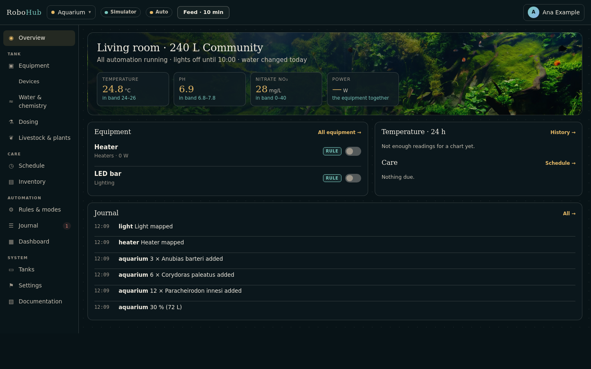
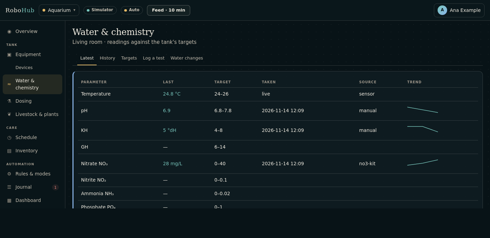
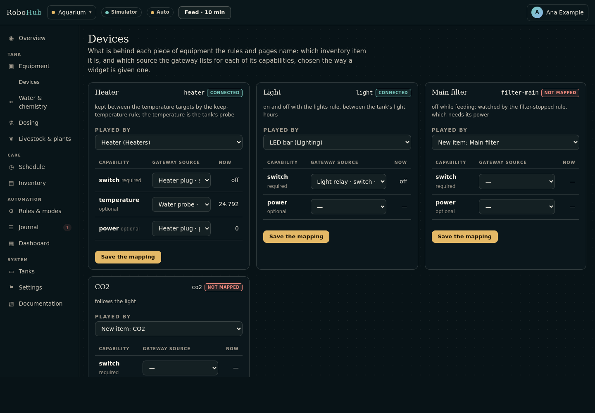
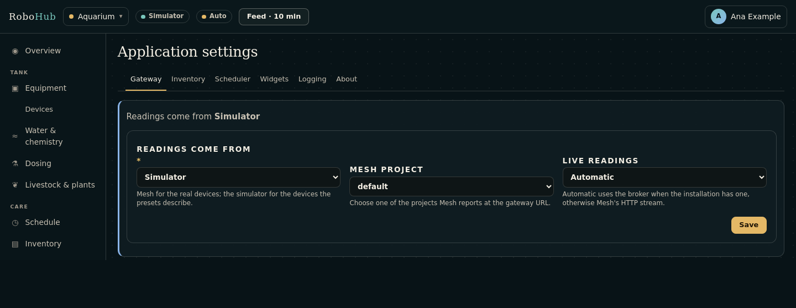

# Aquarium

The aquarium application looks after one or more tanks: their water and its
chemistry, the equipment that keeps them, the doses, livestock and plants, and the
care they need. It keeps the temperature, the lights and the CO₂ with rules, reminds
you of water changes and tests, warns when a test is out of its band, and keeps a
journal of everything that happened. It reaches devices only through the gateway
interface — Mesh for real devices, or the simulator when there is no mesh.









## Reaching it

| | |
| --- | --- |
| Through the keeper | `http://127.0.0.1:19090/app/aquarium/` |
| Its own loopback port | `http://127.0.0.1:8480/` |
| Unit | `aquarium` (systemd user unit the keeper writes) |

The aquarium is a keeper-hosted application: the keeper installs it, signs people in
and runs it ({ref}`keeper/index`). A person needs an `aquarium:` grant in the
keeper's Users & access. To run it from a terminal instead:

```sh
rho build .
ROBOHUB_APP_WORKSPACE=/tmp/aquarium RHO_HTTP_ADDR=127.0.0.1:8480 ./build/aquarium
```

## Pages

The rail groups the pages as the work is: the tank, its care, what runs by itself,
and the system. The top bar has a **Feed · 10 min** button that starts the feeding mode.

| Page | Address | What it does |
| --- | --- | --- |
| Overview | `/` | The tank, its newest readings against their target bands, the equipment and its switches, the last day's temperature with the band behind it, what is due (chores and stock to reorder), the lights, the journal |
| Equipment | `/equipment` | Each piece of equipment, what it is bound to, what drives it (a rule or manual), its runtime and power, with its switch |
| Devices | `/devices` | The tank's roles — heater, light, main filter, CO₂ — and which item plays each, with each capability bound to a mesh source |
| Water & chemistry | `/water` | Tabs: **Latest** (each parameter's newest reading and trend), **History**, **Log a test**, **Targets** (the tank's bands), **Water changes** |
| Dosing | `/dosing` | What was added to the water, taken off the product's stock |
| Livestock & plants | `/livestock` | What lives in a tank — fish, invertebrates, corals, plants — how many, and losses |
| Schedule | `/scheduler` | Chores: water changes, tests, rinsing the filter by its runtime, cleaning the glass |
| Inventory | `/expenses` | Food, test kits, fertilisers, filter media and equipment, with their stock and purchases |
| Rules | `/rules` | The rules and modes, their state, editing a rule and putting a preset back |
| Journal | `/journal` | Everything that happened; open warnings are resolved here |
| Dashboard | `/widgets` | A dashboard of widgets over the tank's values |
| Tanks | `/tank` | Each tank's name, kind, volume and light hours, and the one shown by default |
| Settings | `/settings` | See below |
| Documentation | `/docs` | This guide, embedded in the program |

Older addresses — `/chemistry`, `/automation`, `/modes`, `/events` — lead to the pages
that replaced them.

### Water tests and bands

A test is a reading of one parameter — temperature, pH, KH, GH, nitrate, nitrite,
ammonia, phosphate — by a kit (an inventory consumable a test uses up) or a sensor.
**Log a test** has a row per parameter, with the kit each used; rows left empty are
not tests. Against the tank's band a reading is in, low or high; out of band is a
journal warning — a notification, and an open entry until someone resolves it. A
water change logged is that tank's "Water change" chore done.

A tank's bands are seeded from its kind (planted, community, reef, pond) and changed
on the **Targets** tab; changing a tank's kind gives it that kind's bands.

### Deleting a record

A water test, a water change or a dose entered by mistake is deleted from its row,
after a confirmation. Deleting a dose puts what it took back on the product's stock.
A loss is recorded against livestock rather than deleting it. Inventory items,
purchases, chores and widgets are deleted on their own pages.

### Several tanks

Each tank has its own roles, rules and chores. The first tank — the one made first —
keeps the plain names: `heater`, `keep-temperature`, "Water change". Every other
tank's carry its handle: `reef-nano-heater`, `reef-nano-keep-temperature`,
"Water change · Reef nano". They are made from the presets when the tank is added,
kept current at every start, and follow its light hours when they change.

The pages show the tank chosen on the Tanks page; another is a click away
(`?tank=<id>` on any page — the Devices page shows the roles of the tank it is opened
for). The overview and the Water page read the temperature from that tank's heater.
The feeding and maintenance modes act on the first tank's equipment.

### Equipment, roles and rules

The preset rules name equipment by role: `heater`, `light`, `filter-main`, `co2`. On
the Devices page give each role an item — any equipment, or a new one — and bind its
capabilities: the heater's switch to its plug and its temperature to a probe. Until
then the rules read nothing, do nothing, and say so on the Rules page.

| Role | Needs | Used by |
| --- | --- | --- |
| `heater` | switch, temperature (optional), power (optional) | `keep-temperature`, `too-warm` |
| `light` | switch, power (optional) | `lights`, between the tank's light hours |
| `filter-main` | switch, power (optional) | `filter-stopped`; off while feeding |
| `co2` | switch | `co2-follows-light` |

The temperature rules compare with the tank's own band: `band.temperature.on` and
`.off` are a quarter of the band in from each end — where the heater switches on and
off — and `.alarm` is two degrees past the top. Another tank's are
`<handle>.band.temperature.on` and so on. A rule may name any parameter's band
(`band.no3.high`) or a tank's newest result (`no3 > 25`).

| Mode | What it does |
| --- | --- |
| Feeding | Main filter off for ten minutes; `filter-stopped` suspended |
| Maintenance | Main filter and heater off until ended; the temperature and filter rules suspended |

### Presets

What each shared module starts with is in `presets/`, embedded in the program:

| File | What it seeds |
| --- | --- |
| `targets.yml` | the kinds of tank and their bands |
| `roles.yml` | the roles and what each needs from the mesh |
| `rules.yml` | the rules and the feeding and maintenance modes |
| `schedule.yml` | water change, water test, filter rinse, glass cleaning |
| `inventory.yml` | the inventory's categories and first items |
| `api.yml` | the values offered to other applications |
| `sim.yml` | the simulated devices |

## Settings

| Tab | What it holds |
| --- | --- |
| Gateway | Where readings come from (Mesh or the simulator), Mesh's project, and how its changes arrive: automatically, over the broker or over HTTP. |
| Inventory | The inventory module's own settings. |
| Scheduler | The scheduler's own settings. |
| Widgets | The dashboard's own settings. |
| Logging | Level, text or JSON, rotating file, size, retention, standard error. |
| About | The gateway in use and the application's API. |

Mesh's address and the token it is read with come from the keeper; nothing is copied
into the aquarium. The gateway settings are the binding's, written to `bind.conf` in
the workspace.

## How it connects to the rest

| What | How |
| --- | --- |
| `robohub.gateway` | Bound to {ref}`robohub-provider-mesh/index` (Mesh at `http://127.0.0.1:8478`, project `default`, transport `auto`) and to the simulator, off by default. |
| `robohub.bus` | Bound to `robohub-provider-mqtt`: subscribes to `mesh/+/telemetry`, the live feed Mesh relays. |
| Calls | `deploy.calls: [mesh]` — the keeper makes it a client of Mesh. |
| Shared modules | {ref}`inventory/index` (items and the equipment's automation, the Devices page), `scheduler`, `rules`, `journal`, `widgets`, `appapi`, `simulator`, `appshell`, `ui`, `forms`, `notifications`, `settings`, `i18n`, `logging`, `htmx`. |
| Host hooks | `host_app`, `host_app_title`, `host_shell`, `host_settings_tabs`/`form`/`save`, `host_devices_*` — how the shared modules draw inside the aquarium. |

## API

Under the aquarium's sign-in; another application asks with a service token.

| Method and path | What it answers |
| --- | --- |
| `GET /api/v1/values` | Every value the aquarium offers: each tank's newest results as `<tank>.<parameter>` (and `<parameter>` for the first tank), the water temperature, its 24-hour average, days since the last water change, the heater's energy this week |
| `GET /api/v1/values/{id}` | One value |
| `GET /api/v1/values/{id}/history` | Its history |
| `GET /api/v1/events` | What happened, as events |
| `GET /api/journal` | The journal |
| `GET /api/rules` | The rules and their state |
| `GET`/`POST /api/scheduler/chores` | The chores; add one |
| `POST /api/scheduler/chores/{id}/complete`, `/snooze`, `/usage` | Complete, snooze or record usage of a chore |
| `GET /api/widgets`, `POST /api/widgets/{id}/value`, `/press` | The dashboard's widgets |
| `GET /api/expenses/count` | How many inventory items there are |

## Operating notes

| What | Where |
| --- | --- |
| Workspace | `~/.rho/keeper/workspaces/aquarium` under the keeper (`ROBOHUB_APP_WORKSPACE`) |
| Database | `data/app.db` in the workspace: tanks, tests, doses, livestock and the shared modules' records |
| Settings, bindings | `data/settings.conf`, `bind.conf` in the workspace |

**Logs.** The aquarium logs to standard error, kept by its unit's journal (the
keeper's **Log**, or `journalctl --user -u aquarium`); the Logging tab adds a
rotating file.

**Backup.** Copy the workspace with the aquarium stopped; `data/app.db` is everything
the aquarium knows, and `bind.conf` and `data/settings.conf` what it was told.

**Tests.** `rho test .` builds the aquarium and walks it over HTTP.
